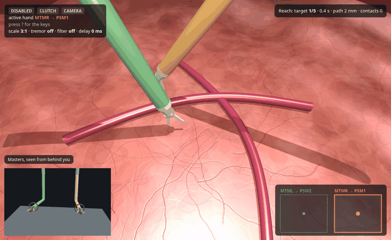
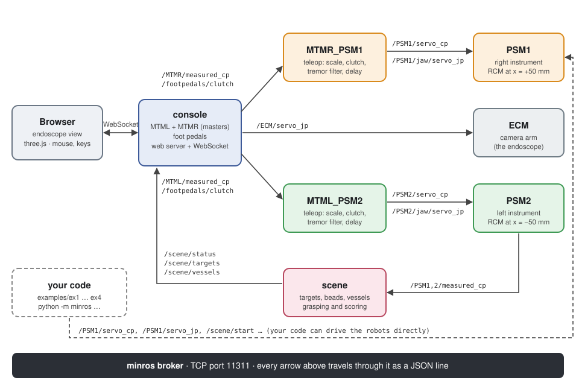
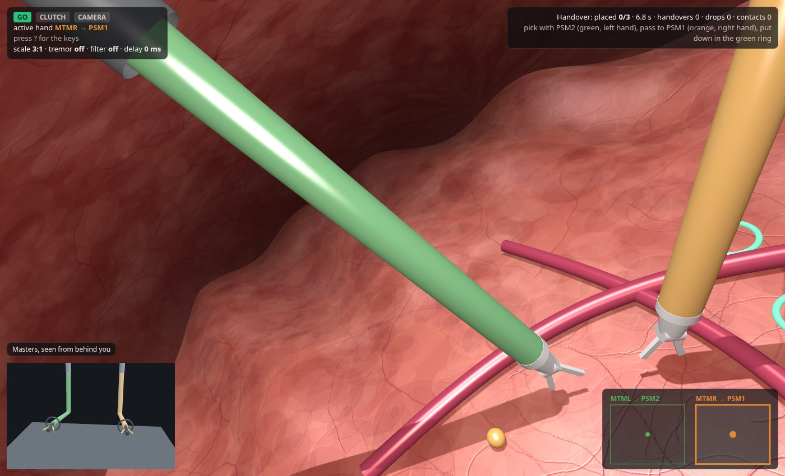

# dVRK mini simulator


A small, readable simulator of the **da Vinci Research Kit**
written in pure Python. It comes with **minros**, a miniature ROS: nodes that
run as separate processes, topics, publishers, subscribers, timers,
parameters and command-line tools that copy the `ros2` command.

Same ideas and the same topic names they would use on a
real dVRK (`/PSM1/measured_cp`, `/PSM1/servo_cp`, `/MTMR_PSM1/...`), without
installing ROS, Linux or anything beyond NumPy and Matplotlib.

> This is a teaching model. PSM and MTM kinematics are simplified (an ideal
> remote center of motion, joint conventions not identical to the dVRK),
> there is no dynamics, grasping is a simple rule rather than contact
> physics, collisions only stop the motion (no forces, see
> [Collisions](#collisions)), and the camera is a single (not stereo) endoscope.



*PSM1 touching the five targets by itself, driven by
[`examples/ex3_autonomous_targets.py`](examples/ex3_autonomous_targets.py)
(sped up about 3×).*

## Install and run

Python 3.8 or newer on Windows, macOS or Linux, and a recent web browser.
Open terminal and run:

```bash
pwd #to verify where you are 
cd """" #path to the directory dvrk_mini_sim; do yourself a favor: right click on dvrk_mini_sim and click on copy path :)
#EXAMPLE ON MY PC: "C:\Users\Leo\Desktop\dvrk_mini_sim"

pip install -r requirements.txt
python launch.py
```

`launch.py` starts eight processes, like a ROS launch file: the broker, two
instrument arms (`PSM1`, `PSM2`), the camera arm (`ECM`), two teleoperation
nodes (`MTMR_PSM1` for the right hand, `MTML_PSM2` for the left, the same
pairing as on the dVRK), the `scene`, and the surgeon `console`. The console
opens your browser at <http://127.0.0.1:8080/> with the endoscope view.

Use Chrome, Edge or Firefox.



Each box is a separate process (a node). The arrows are the main topics; the
full list is in [Topics](#topics). As in ROS, nothing talks to anything
directly: every message goes through the minros broker (see
[How minros works](#how-minros-works)), so your own scripts can listen to or
drive the robots exactly like the built-in nodes do.

## The endoscope view

What you see is what the surgeon sees in the viewer: the image from the
camera held by the ECM, rendered in 3D with the endoscope's own light and
shadows on the tissue. PSM1 (orange shaft) enters from the right, PSM2
(green shaft) from the left, each through its port in the abdominal wall.

Click the view to **sit at the console**: the mouse pointer disappears and
your mouse becomes the active master, as if your hand were on it. Esc
stands up. Bottom left you see the two masters (MTML, MTMR) moving from
their joint values; bottom right the two hand workspaces, useful to see when
a hand reaches its limit and needs the clutch.

You control **one hand at a time**. Tab switches hand; the hand you leave
stays still, and so does its instrument. G keeps the active jaws closed, so
one arm can hold an object while you move the other.

Hand motion is mapped **in the camera image**, as on the real console:
moving the mouse right moves the instrument right on screen, the wheel
pushes it away from you or pulls it back, whatever direction the camera is
pointing. Try moving the camera (V, then the mouse; or the arrow keys) and
notice that the instruments still follow your hand naturally.



*The same scene after moving the ECM with the camera pedal: the view
changes, but "right" on screen is still "right" for your hand.*

| Input | Effect |
| --- | --- |
| Click on the view / Esc | sit at the console / stand up |
| Tab or `X` | switch the active hand (MTML ↔ MTMR) |
| Mouse | move the active hand: left/right and up/down in the image |
| Scroll wheel, `W` / `S` | move it into the image or back (depth) |
| Left button held | close the active hand's jaws |
| `G` | keep the active hand's jaws closed (toggle) |
| `J L`, `I K`, `U O`, `H` | rotate the active wrist, reset |
| `C` or space | clutch pedal: hands move freely, instruments stay |
| `V` | camera pedal (toggle): the mouse moves the camera, the wheel zooms |
| Arrows, PgUp, PgDn, Home | move the camera, zoom, back to the start position |
| `1` `2` `3` `5` | motion scale for both arms |
| `T` | simulated physiological tremor, about 10 Hz, on both hands |
| `F` | tremor filter in both teleoperation nodes |
| `R` | force feedback on/off (pseudo-haptic resistance on the hand) |
| `+` / `-` | artificial communication delay, 50 ms steps |
| `N` | reach task: touch the yellow targets in order with either instrument |
| `B` | handover task: see below |
| `Y` | realistic anatomy on / off: see below |
| `Z` | surgeon viewer: only what a surgeon sees in the console |
| `?` | show or hide the list of keys |

The web console works like **rosbridge** does in ROS: a small server inside
the `console` node (`dvrk_sim/web_console.py`, standard library only) sends
the robots' state to the page through a WebSocket 50 times a second, and the
page sends mouse and keyboard events back. 


### Taking control, as on the clinical robot

The instruments do not follow your hand as soon as you sit down. As on the da
Vinci (and in the dVRK teleoperation):

1. **head in**: clicking the view puts your head in the viewer
   (`/console/operator_present`); Esc takes it out and locks the instruments;
2. **alignment**: each master turns until its handle has the orientation of
   its instrument as seen in the camera (the teleoperation asks for it on
   `/MTMR/move_cp`; watch the masters turn in the inset);
3. **squeeze**: press the left button (the grip) to take control of that
   arm. Only then does it follow (FOLLOWING); the other hand needs its own
   squeeze after Tab.

Leaving the console, or a script that pauses the teleoperation, gives the
control up: next time align and squeeze again. The clutch does not.
`python -m minros param set MTMR_PSM1 require_operator false` restores the
old behaviour.

### Surgeon viewer (Z)

**Z** hides everything that is not in a real surgeon console (key list,
panels, insets) and shows a viewer interface inspired by the clinical one:
the instrument of each arm with its number and state at the bottom corners
(in control, squeeze to take control, contact, range of motion), the
messages of the system at the top, the pedals and the motion scale at the
bottom, and an arrow on the edge of the image towards an instrument that is
out of view. Z again goes back to the normal view.

### The handover task

A classic bimanual exercise. For each orange bead:


Each bead has its own ring, drawn **in the same colour** (blue, magenta,
yellow…): a bead counts only in its own ring. When it is placed, bead and
ring turn **green**. Green always means "done".


1. bring PSM2 (left hand) onto the bead and close its jaws;
2. lift it and bring PSM1 (right hand) next to it, close PSM1's jaws;
3. open PSM2's jaws: the bead now belongs to PSM1 (one handover);
4. put the bead down inside the ring of its colour and open PSM1's jaws.

A bead released anywhere else (also in a ring of another colour) falls on
the tissue and counts as a drop; you
can pick it up again. In the classic console the bottom line shows the
distance from the active instrument to the nearest bead along each axis, which
helps with depth on a flat screen. In the endoscope view, the shadows of the
instruments on the tissue are your best depth cue. Use G on the holding hand
before switching hands.

### Collisions

The instruments cannot go through the tissue, the abdominal wall or each
other, and the endoscope cannot be pulled back into the wall. The model is
geometric (`dvrk_sim/kinematics.py`): each instrument is a chain of capsules
(shaft, clevis, two jaws), the tissue is the floor of the cavity and the wall
is the inside of the dome, with the ports (the RCMs) inside it. Each PSM node
refuses the part of a motion that would push its instrument into an
obstacle; a tip command below the tissue is projected onto it, so the tip
slides along the surface. There are no forces: think of it as a safety layer
or a virtual fixture, not as contact physics.

What an instrument touches is published on `/PSM1/collision` and shown in the
view the same way as a vessel contact: the border of the screen and the
instrument turn **red** when it touches tissue (a vessel, the tissue, the
abdominal wall) and **yellow** when the two instruments collide. The scene
counts vessel contacts, tissue touches and clashes separately, and ignores the
two jaws meeting around a bead during a handover. Vessels are still soft: you
can press into them, and each contact is counted. `python -m minros param set PSM1 collisions false` turns
the checks off for one arm.

### Force feedback

Each PSM estimates the contact force on its tool with the classic
**god-object (proxy)** method of haptics: the instrument stops on the
surface, the point your hand commands goes on into the obstacle, and a spring
between the two pushes back, `F = stiffness × (actual tip − commanded tip)`
along the contact normal (outwards only). Tissue, abdominal wall and the other
instrument are stiff (300 N/m); the vessels are soft (120 N/m) and do not
stop the instrument.

The chain is the one of a real dVRK with motorised masters:

```
PSM1 --/PSM1/measured_cf--> MTMR_PSM1 --/MTMR/servo_cf--> console (MTMR)
        world frame           camera -> hand frame,         renders it on
                              force_scale, delay            the hand
```

A mouse cannot push your hand, so the console renders the force as
**pseudo-haptic resistance**: the virtual hand is pushed along the force
(an admittance). Pushing an instrument into the tissue feels "hard": the hand
keeps sliding back until the instrument is just on the surface; a vessel
gives way slowly. **R** turns the feedback on and off; the HUD shows the force.
With a real haptic device you would read `/MTMR/servo_cf` instead.

Try it with the delay (**+**): the force comes back late too, and with a few
hundred milliseconds the hand gets kicked back out of the tissue. That is
why force feedback and long-distance telesurgery do not mix easily.

Parameters: `python -m minros param set PSM1 stiffness 500`
(also `vessel_stiffness`, `max_force`) and
`python -m minros param set MTMR_PSM1 force_scale 0.5` (or `force_feedback false`).

### Realistic anatomy (task Y)

**Y** moves the robots into a real laparoscopic scene: the gallbladder, liver
and fat of a cholecystectomy, reconstructed in 3D from a real video frame,
with the photo as texture. The instruments are the dVRK **Large Needle
Driver**, drawn from its official CAD (in the classic scene too, with the
coloured shafts: PSM1 orange, PSM2 green).

* The surface is the tissue: collisions, force feedback and the red border
  work on it, and the HUD tells which organ you touch and counts the contacts
  per organ (a new contact each time an instrument touches tissue).
* When the task starts, the camera goes home and the two instruments are
  brought just in front of the gallbladder (left) and the liver (right).
* The reconstruction is seen from one viewpoint only, so the camera arm
  refuses poses from which most of the view would fall past it: you can turn
  it by about 10 degrees, roll it and move it in and out, and at the edges of
  the image you may see a little of the cavity wall past the reconstruction
  (`VIEW_MARGIN` and `VIEW_MISS` in `dvrk_sim/anatomy.py`). The field of view
  is the one of the original laparoscope.
* Y again (or N, B) goes back to the classic scene: camera and instruments
  return to their home pose.

It needs the SurgAware exports in `surgaware_ply_export/` (not part of this
repository: Cholec80-derived textures, CC BY-NC-SA 4.0, non-commercial use
only). `python launch.py` builds the assets the first time
(`web/assets/anatomy/`, a few seconds; also `python -m dvrk_sim.anatomy`).
The instrument CAD (`web/assets/lnd/`) comes from
[jhu-dvrk/dvrk_model](https://github.com/jhu-dvrk/dvrk_model) (MIT) and is
downloaded once with `python -m dvrk_sim.lnd`. The anatomy works in the web
console only.

## Look inside, like with ROS

Open a second terminal in this folder while the simulator runs.

| minros | ROS 2 equivalent |
| --- | --- |
| `python -m minros node list` | `ros2 node list` |
| `python -m minros topic list -v` | `ros2 topic list -t` |
| `python -m minros topic info /PSM1/servo_cp` | `ros2 topic info` |
| `python -m minros topic echo /PSM1/measured_cp --field pose.position` | `ros2 topic echo` |
| `python -m minros topic hz /PSM1/measured_cp` | `ros2 topic hz` |
| `python -m minros topic pub /footpedals/clutch Bool '{"data": true}'` | `ros2 topic pub` |
| `python -m minros param set MTMR_PSM1 scale 2` | `ros2 param set` |
| `python -m minros graph` | `rqt_graph` |

On Windows `cmd`, write the JSON with escaped double quotes:
`"{\"data\": true}"`.

## Topics

Every topic below exists for both pairs: replace MTMR/PSM1 with MTML/PSM2.

| Topic | Type | Publisher → subscribers |
| --- | --- | --- |
| `/MTMR/measured_cp` | PoseStamped | console → teleop, 100 Hz |
| `/MTMR/measured_js` | JointState | console → everyone, 7 MTM joints, 25 Hz |
| `/MTMR/gripper/measured_js` | JointState | console → teleop |
| `/footpedals/clutch` | Bool | console → both teleops |
| `/console/operator_present` | Bool | console → both teleops: head in the viewer |
| `/MTMR/move_cp` | PoseStamped | teleop → console: orientation the master must reach while aligning |
| `/PSM1/servo_cp` | PoseStamped | teleop or your code → PSM1 (world frame) |
| `/PSM1/servo_jp` | JointState | your code → PSM1 |
| `/PSM1/jaw/servo_jp` | JointState | teleop or your code → PSM1 |
| `/PSM1/measured_cp` | PoseStamped | PSM1 → everyone, world frame, 100 Hz |
| `/PSM1/local/measured_cp` | PoseStamped | PSM1 → everyone, RCM frame, 50 Hz |
| `/PSM1/measured_js` | JointState | PSM1 → everyone, 50 Hz |
| `/PSM1/collision` | String (JSON) | PSM1 → everyone: `["tissue", "wall", "PSM2"]` or `[]` |
| `/PSM1/measured_cf` | WrenchStamped | PSM1 → teleop, contact force on the tool, world frame, 100 Hz |
| `/MTMR/servo_cf` | WrenchStamped | teleop → console, force to render on the hand, 100 Hz |
| `/MTMR_PSM1/state` | String (JSON) | teleop → console |
| `/MTMR_PSM1/set_scale` | Float64 | anyone → teleop |
| `/scene/start` | String | `"reach"`, `"handover"`, `"anatomy"` or `"classic"` (no task) → scene |
| `/scene/world` | String | scene → everyone: `"classic"` or `"anatomy"` |
| `/ECM/measured_cp` | PoseStamped | ECM → teleops and console (camera pose) |
| `/ECM/measured_js` | JointState | ECM → everyone (yaw, pitch, insertion, roll) |
| `/ECM/servo_jp` | JointState | console or your code → ECM |
| `/scene/targets` | PoseArray | scene → everyone |
| `/scene/vessels` | PolylineArray | scene → everyone |
| `/scene/status` | String (JSON) | scene → everyone (task, timing, beads and their colours, counts) |

Coordinates are in metres. `measured_cp` and `servo_cp` use a shared world
frame (x right, y forward, z up, abdominal wall at z = 0, patient below);
PSM1's RCM is at x = +50 mm, PSM2's at x = −50 mm and the ECM's at
y = −90 mm. The camera frame follows the dVRK: z is the viewing direction,
x points right in the image, y down. `local/measured_cp`
is relative to the arm's own RCM, as on the dVRK. Joint names, limits and
the MTM model are in `dvrk_sim/kinematics.py`.

## Exercises

Run them in a second terminal while `python launch.py` is open.

1. `python examples/ex1_listener.py`: subscribers that print both tip positions.
2. `python examples/ex2_draw_circle.py 20 4`: a publisher; the robot draws a
   circle by itself (teleoperation is paused and then restored).
3. `python examples/ex3_autonomous_targets.py 30`: PSM1 does the reach task
   on its own. It ignores the vessels: make it avoid them, then use both arms.
4. `python examples/ex4_record_and_plot.py`: record a trial, save a CSV and
   plot trajectory and speed, the starting point for skill assessment.


*What ex4 shows when ex3 does the reach task at 30 mm/s: straight lines
between the targets, constant speed, and a stop on each target. A human trial
looks much less tidy, which is the point.*

`python launch.py --no-gui` runs the robots without the window, handy for
scripted experiments.


## How minros works

`minros/broker.py` is a small TCP server on port 11311 (the ROS 1 master
port). Every node connects to it, announces its topics and sends messages as
JSON lines; the broker forwards each message to the subscribers. Real ROS 1
uses the master only for discovery and connects nodes directly; ROS 2 has no
master and uses DDS. The API in `minros/core.py` follows `rclpy`, so porting
a node to ROS 2 mostly means changing imports:

```python
# minros                                   # ROS 2
import minros                              import rclpy
from minros.msg import PoseStamped         from geometry_msgs.msg import PoseStamped
minros.init()                              rclpy.init()
node = minros.Node("listener")             node = rclpy.create_node("listener")
node.create_subscription(PoseStamped,      node.create_subscription(PoseStamped,
    "/PSM1/measured_cp", cb, 10)               "/PSM1/measured_cp", cb, 10)
minros.spin(node)                          rclpy.spin(node)
```


## Files

```
launch.py               starts everything
minros/                 the miniature ROS (broker, node API, messages, CLI)
dvrk_sim/kinematics.py  PSM kinematics around the RCM, arm bases, MTM model, collision geometry
dvrk_sim/psm_node.py    simulated PSM (one process per arm)
dvrk_sim/teleop_node.py MTM -> PSM teleoperation: scale, clutch, filter, delay
dvrk_sim/scene_node.py  reach and handover tasks, vessels, grasping, scoring
dvrk_sim/ecm_node.py    simulated ECM, the camera arm
dvrk_sim/console_node.py the console node: MTML and MTMR, pedals, camera commands
dvrk_sim/web_console.py web server + WebSocket bridge for the endoscope view
dvrk_sim/console_gui.py classic Matplotlib console (--classic)
web/                    the endoscope view page (index.html, app.js, three.js)
examples/               exercises for students
docs/images/            screenshots and diagram used in this README
LICENSE, CITATION.cff   MIT license and how to cite this repository
tests/                  kinematics and collision geometry tests (python tests/test_kinematics.py)
```

## How to cite

If you use this simulator in a course, a paper, a thesis or in software
derived from it, please cite this repository:

> Laura Cruciani, *dVRK mini simulator*, 2026. https://github.com/LauraCruciani/dvrk_mini_sim

```bibtex
@software{cruciani_dvrk_mini_sim_2026,
  author = {Cruciani, Laura; Passoni, Leonardo},
  title  = {{dVRK} mini simulator},
  year   = {2026},
  url    = {https://github.com/LauraCruciani/dvrk_mini_sim}
}
```

GitHub also offers these formats from the **Cite this repository** button,
generated from [`CITATION.cff`](CITATION.cff).

## License

[MIT](LICENSE). You are free to use, change and share the code, as long as
every copy keeps the copyright notice, which includes the link to this
repository. three.js (`web/three.min.js`) is MIT-licensed by its authors.
