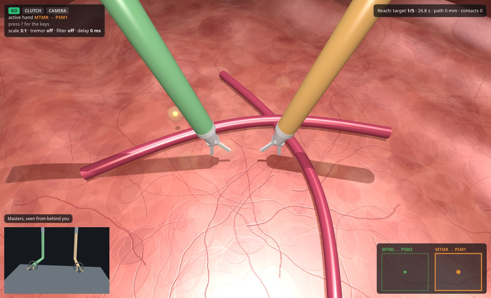
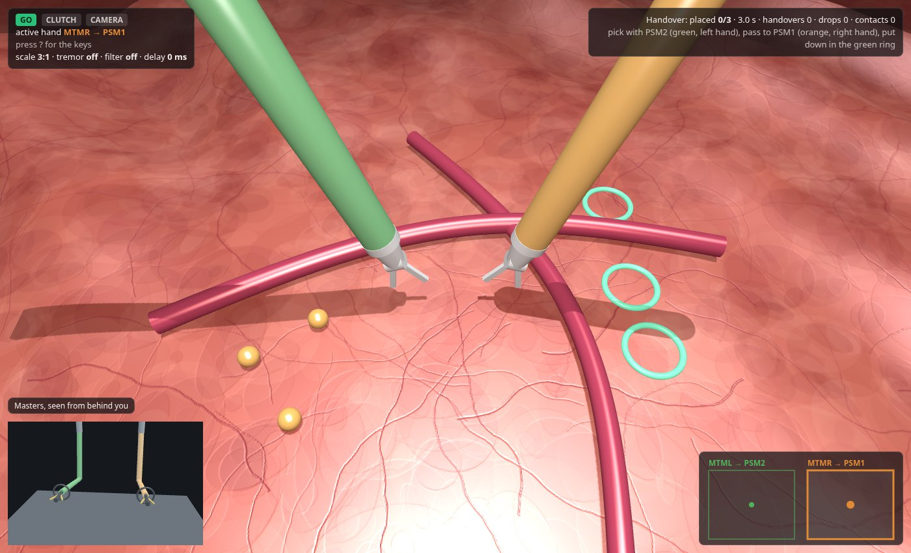
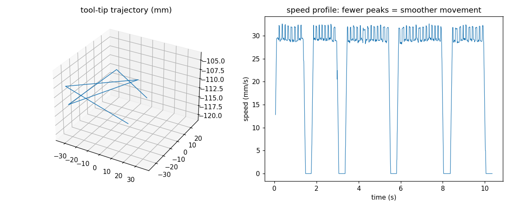

# dVRK mini simulator



A small, readable simulator of the **da Vinci Research Kit**
written in pure Python. It comes with **minros**, a miniature ROS: nodes that
run as separate processes, topics, publishers, subscribers, timers,
parameters and command-line tools that copy the `ros2` command.

Same ideas and the same topic names they would use on a
real dVRK (`/PSM1/measured_cp`, `/PSM1/servo_cp`, `/MTMR_PSM1/...`), without
installing ROS, Linux or anything beyond NumPy and Matplotlib.

> PSM and MTM kinematics are simplified (an ideal
> remote center of motion, joint conventions not identical to the dVRK),
> there is no dynamics, grasping is a simple rule rather than contact
> physics, and the camera is a single (not stereo) endoscope.


*PSM1 touching the five targets by itself, driven by
[`examples/ex3_autonomous_targets.py`](examples/ex3_autonomous_targets.py)
(sped up about 3×).*

## Install and run

Python 3.8 or newer on Windows, macOS or Linux, and a recent web browser.

```bash
pip install -r requirements.txt
python launch.py
```

`launch.py` starts eight processes, like a ROS launch file: the broker, two
instrument arms (`PSM1`, `PSM2`), the camera arm (`ECM`), two teleoperation
nodes (`MTMR_PSM1` for the right hand, `MTML_PSM2` for the left, the same
pairing as on the dVRK), the `scene`, and the surgeon `console`. The console
opens your browser at <http://127.0.0.1:8080/> with the endoscope view.

Use Chrome, Edge or Firefox.


Each box is a separate process (a node). The arrows are the main topics; the
full list is in [Topics](#topics). As in ROS, nothing talks to anything
directly: every message goes through the minros broker (see
[How minros works](#how-minros-works)), so your own scripts can listen to or
drive the robots exactly like the built-in nodes do.

## The endoscope view

What you see is what the surgeon sees in the viewer: the image from the
camera held by the ECM, rendered in 3D with the endoscope's own light and
shadows on the tissue. PSM1 (orange shaft) enters from the right, PSM2
(green shaft) from the left, each through its port in the abdominal wall.

Click the view to **sit at the console**: the mouse pointer disappears and
your mouse becomes the active master, as if your hand were on it. Esc
stands up. Bottom left you see the two masters (MTML, MTMR) moving from
their joint values; bottom right the two hand workspaces, useful to see when
a hand reaches its limit and needs the clutch.

You control **one hand at a time**. Tab switches hand; the hand you leave
stays still, and so does its instrument. G keeps the active jaws closed, so
one arm can hold an object while you move the other.

Hand motion is mapped **in the camera image**, as on the real console:
moving the mouse right moves the instrument right on screen, the wheel
pushes it away from you or pulls it back, whatever direction the camera is
pointing. Try moving the camera (V, then the mouse; or the arrow keys) and
notice that the instruments still follow your hand naturally.


*The same scene after moving the ECM with the camera pedal: the view
changes, but "right" on screen is still "right" for your hand.*

| Input | Effect |
| --- | --- |
| Click on the view / Esc | sit at the console / stand up |
| Tab or `X` | switch the active hand (MTML ↔ MTMR) |
| Mouse | move the active hand: left/right and up/down in the image |
| Scroll wheel, `W` / `S` | move it into the image or back (depth) |
| Left button held | close the active hand's jaws |
| `G` | keep the active hand's jaws closed (toggle) |
| `J L`, `I K`, `U O`, `H` | rotate the active wrist, reset |
| `C` or space | clutch pedal: hands move freely, instruments stay |
| `V` | camera pedal (toggle): the mouse moves the camera, the wheel zooms |
| Arrows, PgUp, PgDn, Home | move the camera, zoom, back to the start position |
| `1` `2` `3` `5` | motion scale for both arms |
| `T` | simulated physiological tremor, about 10 Hz, on both hands |
| `F` | tremor filter in both teleoperation nodes |
| `+` / `-` | artificial communication delay, 50 ms steps |
| `N` | reach task: touch the yellow targets in order with either instrument |
| `B` | handover task: see below |
| `?` | show or hide the list of keys |

The web console works like **rosbridge** does in ROS: a small server inside
the `console` node (`dvrk_sim/web_console.py`, standard library only) sends
the robots' state to the page through a WebSocket 50 times a second, and the
page sends mouse and keyboard events back. 


### The handover task

A classic bimanual exercise. For each orange bead:




1. bring PSM2 (left hand) onto the bead and close its jaws;
2. lift it and bring PSM1 (right hand) next to it, close PSM1's jaws;
3. open PSM2's jaws: the bead now belongs to PSM1 (one handover);
4. put the bead down inside its green ring and open PSM1's jaws.

A bead released anywhere else falls on the tissue and counts as a drop; you
can pick it up again. In the classic console the bottom line shows the
distance from the active instrument to the nearest bead along each axis, which
helps with depth on a flat screen. In the endoscope view, the shadows of the
instruments on the tissue are your best depth cue. Use G on the holding hand
before switching hands.

## Look inside, like with ROS

Open a second terminal in this folder while the simulator runs.

| minros | ROS 2 equivalent |
| --- | --- |
| `python -m minros node list` | `ros2 node list` |
| `python -m minros topic list -v` | `ros2 topic list -t` |
| `python -m minros topic info /PSM1/servo_cp` | `ros2 topic info` |
| `python -m minros topic echo /PSM1/measured_cp --field pose.position` | `ros2 topic echo` |
| `python -m minros topic hz /PSM1/measured_cp` | `ros2 topic hz` |
| `python -m minros topic pub /footpedals/clutch Bool '{"data": true}'` | `ros2 topic pub` |
| `python -m minros param set MTMR_PSM1 scale 2` | `ros2 param set` |
| `python -m minros graph` | `rqt_graph` |

On Windows `cmd`, write the JSON with escaped double quotes:
`"{\"data\": true}"`.

## Topics

Every topic below exists for both pairs: replace MTMR/PSM1 with MTML/PSM2.

| Topic | Type | Publisher → subscribers |
| --- | --- | --- |
| `/MTMR/measured_cp` | PoseStamped | console → teleop, 100 Hz |
| `/MTMR/measured_js` | JointState | console → everyone, 7 MTM joints, 25 Hz |
| `/MTMR/gripper/measured_js` | JointState | console → teleop |
| `/footpedals/clutch` | Bool | console → both teleops |
| `/PSM1/servo_cp` | PoseStamped | teleop or your code → PSM1 (world frame) |
| `/PSM1/servo_jp` | JointState | your code → PSM1 |
| `/PSM1/jaw/servo_jp` | JointState | teleop or your code → PSM1 |
| `/PSM1/measured_cp` | PoseStamped | PSM1 → everyone, world frame, 100 Hz |
| `/PSM1/local/measured_cp` | PoseStamped | PSM1 → everyone, RCM frame, 50 Hz |
| `/PSM1/measured_js` | JointState | PSM1 → everyone, 50 Hz |
| `/MTMR_PSM1/state` | String (JSON) | teleop → console |
| `/MTMR_PSM1/set_scale` | Float64 | anyone → teleop |
| `/scene/start` | String | `"reach"` or `"handover"` → scene |
| `/ECM/measured_cp` | PoseStamped | ECM → teleops and console (camera pose) |
| `/ECM/measured_js` | JointState | ECM → everyone (yaw, pitch, insertion, roll) |
| `/ECM/servo_jp` | JointState | console or your code → ECM |
| `/scene/targets` | PoseArray | scene → everyone |
| `/scene/vessels` | PolylineArray | scene → everyone |
| `/scene/status` | String (JSON) | scene → everyone (task, timing, beads, counts) |

Coordinates are in metres. `measured_cp` and `servo_cp` use a shared world
frame (x right, y forward, z up, abdominal wall at z = 0, patient below);
PSM1's RCM is at x = +50 mm, PSM2's at x = −50 mm and the ECM's at
y = −90 mm. The camera frame follows the dVRK: z is the viewing direction,
x points right in the image, y down. `local/measured_cp`
is relative to the arm's own RCM, as on the dVRK. Joint names, limits and
the MTM model are in `dvrk_sim/kinematics.py`.

## Exercises

Run them in a second terminal while `python launch.py` is open.

1. `python examples/ex1_listener.py`: subscribers that print both tip positions.
2. `python examples/ex2_draw_circle.py 20 4`: a publisher; the robot draws a
   circle by itself (teleoperation is paused and then restored).
3. `python examples/ex3_autonomous_targets.py 30`: PSM1 does the reach task
   on its own. It ignores the vessels: make it avoid them, then use both arms.
4. `python examples/ex4_record_and_plot.py`: record a trial, save a CSV and
   plot trajectory and speed, the starting point for skill assessment.



*What ex4 shows when ex3 does the reach task at 30 mm/s: straight lines
between the targets, constant speed, and a stop on each target. A human trial
looks much less tidy, which is the point.*

`python launch.py --no-gui` runs the robots without the window, handy for
scripted experiments.


## How minros works

`minros/broker.py` is a small TCP server on port 11311 (the ROS 1 master
port). Every node connects to it, announces its topics and sends messages as
JSON lines; the broker forwards each message to the subscribers. Real ROS 1
uses the master only for discovery and connects nodes directly; ROS 2 has no
master and uses DDS. The API in `minros/core.py` follows `rclpy`, so porting
a node to ROS 2 mostly means changing imports:

```python
# minros                                   # ROS 2
import minros                              import rclpy
from minros.msg import PoseStamped         from geometry_msgs.msg import PoseStamped
minros.init()                              rclpy.init()
node = minros.Node("listener")             node = rclpy.create_node("listener")
node.create_subscription(PoseStamped,      node.create_subscription(PoseStamped,
    "/PSM1/measured_cp", cb, 10)               "/PSM1/measured_cp", cb, 10)
minros.spin(node)                          rclpy.spin(node)
```


## Files

```
launch.py               starts everything
minros/                 the miniature ROS (broker, node API, messages, CLI)
dvrk_sim/kinematics.py  PSM kinematics around the RCM, arm bases, MTM model
dvrk_sim/psm_node.py    simulated PSM (one process per arm)
dvrk_sim/teleop_node.py MTM -> PSM teleoperation: scale, clutch, filter, delay
dvrk_sim/scene_node.py  reach and handover tasks, vessels, grasping, scoring
dvrk_sim/ecm_node.py    simulated ECM, the camera arm
dvrk_sim/console_node.py the console node: MTML and MTMR, pedals, camera commands
dvrk_sim/web_console.py web server + WebSocket bridge for the endoscope view
dvrk_sim/console_gui.py classic Matplotlib console (--classic)
web/                    the endoscope view page (index.html, app.js, three.js)
examples/               exercises for students
docs/images/            screenshots and diagram used in this README
LICENSE, CITATION.cff   MIT license and how to cite this repository
tests/                  kinematics tests for PSM and MTM (python tests/test_kinematics.py)
```

## How to cite

If you use this simulator in a course, a paper, a thesis or in software
derived from it, please cite this repository:

> Laura Cruciani, *dVRK mini simulator*, 2026. https://github.com/LauraCruciani/dvrk_mini_sim

```bibtex
@software{cruciani_dvrk_mini_sim_2026,
  author = {Cruciani, Laura},
  title  = {{dVRK} mini simulator},
  year   = {2026},
  url    = {https://github.com/LauraCruciani/dvrk_mini_sim}
}
```

GitHub also offers these formats from the **Cite this repository** button,
generated from [`CITATION.cff`](CITATION.cff).

## License

[MIT](LICENSE). You are free to use, change and share the code, as long as
every copy keeps the copyright notice, which includes the link to this
repository. three.js (`web/three.min.js`) is MIT-licensed by its authors.
